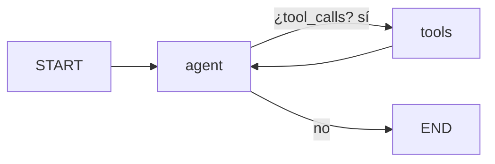

# Pre-entrega 5 — Agente de razonamiento cíclico con memoria persistente

Agente ReAct construido con **LangGraph** que responde consultas sobre clientes y pedidos. Decide por sí mismo cuándo llamar a una herramienta, encadena varias llamadas cuando hace falta, se recupera de errores y recuerda la conversación entre ejecuciones gracias a un checkpointer en SQLite.



- **agent**: LLM de Anthropic con las herramientas vinculadas (`bind_tools`).
- **tools**: `ToolNode` que ejecuta las herramientas pedidas y devuelve `ToolMessage`s.
- **`tools_condition`**: arista condicional; si el último mensaje trae `tool_calls` va a `tools`, si no a `END`.

## Requisitos

- Python 3.12 o superior (desarrollado y probado con 3.14).
- Una API key de Anthropic.

## Instalación

```bash
python -m venv .venv
source .venv/bin/activate      # Windows: .venv\Scripts\activate
pip install -r requirements.txt
cp .env.example .env           # completar ANTHROPIC_API_KEY
```

Variables de `.env`:

| Variable | Default | Descripción |
|---|---|---|
| `ANTHROPIC_API_KEY` | — | Obligatoria. |
| `ANTHROPIC_MODEL` | `claude-sonnet-5-5` | Modelo a usar. |
| `CHECKPOINT_DB` | `checkpoints.db` | Archivo SQLite de los checkpoints. |
| `RECURSION_LIMIT` | `10` | Techo de pasos del grafo por turno. |
| `MAX_CONTEXT_MESSAGES` | `20` | Mensajes del historial que se envían al LLM. |
| `TEMPERATURE` | sin definir | Opcional; ver nota abajo. |

> **Nota sobre `temperature`**: los modelos actuales de Anthropic (Sonnet 5.5, Opus 5.5) rechazan con un 400 los valores no default de `temperature`, así que por defecto no se envía. Con un modelo que la acepte (por ejemplo `claude-haiku-4-5`) se puede fijar `TEMPERATURE=0`.

## Uso

```bash
python main.py demo
```

Corre los cuatro escenarios, escribe las trazas en `traces/` y muestra un resumen PASS/FAIL (orientativo: el LLM no es determinista).

```bash
python main.py chat --thread-id mi-sesion
```

Chat interactivo sobre un thread. Para comprobar que la memoria sobrevive al proceso: preguntar por un cliente, salir, volver a abrir con el mismo `--thread-id` y preguntar "¿de quién hablábamos?".

## Estructura

```
├── main.py              # CLI: demo de escenarios + chat interactivo
├── src/agent/
│   ├── config.py        # Settings (pydantic-settings)
│   ├── mock_db.py       # "Base de datos" simulada async
│   ├── tools.py         # Herramientas con @tool + esquemas Pydantic
│   ├── graph.py         # Estado, nodo del modelo, grafo y compile
│   └── tracing.py       # Ejecución de un turno y captura de la traza
└── traces/              # Trazas generadas por `python main.py demo`
```

## Arquitectura

**Estado.** `AgentState` hereda de `MessagesState`, que ya define `messages` con el reducer `add_messages`. La consigna menciona `operator.add`; se usa `add_messages` porque, además de concatenar, maneja IDs de mensajes y reemplazos, y es el estándar para chat. Los nodos devuelven solo la actualización parcial (`{"messages": [response]}`).

**Nodo `agent`.** Antepone el system prompt (no se guarda en el estado, así no se duplica en cada vuelta), recorta el historial y llama al LLM con `ainvoke`.

**Nodo `tools`.** `ToolNode(TOOLS, handle_tool_errors=True)`: cualquier excepción —incluidas las fallas de validación de Pydantic sobre los argumentos que generó el LLM— vuelve al modelo como `ToolMessage` en vez de cortar la ejecución.

**Persistencia.** Se usa `AsyncSqliteSaver` (`langgraph.checkpoint.sqlite.aio`), la variante asíncrona de `SqliteSaver`. El `SqliteSaver` síncrono no soporta `ainvoke`/`astream`, y la consigna exige `asyncio`. Guarda una foto del estado después de cada nodo, indexada por `thread_id`, en el archivo `checkpoints.db`.

## Herramientas

Todas son `async`, de solo lectura, con esquema de entrada Pydantic. Los errores de negocio se devuelven como dato (`error` + `sugerencia`) para que el agente pueda reaccionar.

| Herramienta | Entrada | Devuelve | Error / incompleto |
|---|---|---|---|
| `buscar_cliente` | `nombre: str` (≥ 2 caracteres) | `{coincidencias: [{cliente_id, nombre}], ambiguo}` | Sin coincidencias → `error` + `sugerencia`. Más de una → `ambiguo: true` (el agente pide aclaración). |
| `buscar_pedidos` | `cliente_id: int` (> 0) | `{cliente_id, cantidad_pedidos, total, pedidos: [{pedido_id, fecha, total}]}` del más reciente al más antiguo | Cliente inexistente → `error` + sugerencia de usar `buscar_cliente`. |
| `obtener_detalle_pedido` | `pedido_id: int` (> 0) | Pedido completo con `estado` e `items` | Pedido inexistente → `error` + sugerencia de usar `buscar_pedidos`. |

## Cómo se cumplen los criterios de aceptación

- **Autonomía.** No hay ningún `if/else` que elija herramientas: el modelo decide a partir de los docstrings ([src/agent/tools.py](src/agent/tools.py)) y el ruteo lo hace `tools_condition` ([src/agent/graph.py](src/agent/graph.py)). Traza: `traces/01_multipaso.json`.
- **Ciclo de retorno.** Las herramientas devuelven `error` + `sugerencia` y la arista `tools → agent` le devuelve la observación al modelo, que reintenta o pide aclaración. Traza: `traces/03_error_y_reintento.json`.
- **Resiliencia de estado.** `AsyncSqliteSaver` + `thread_id` ([main.py](main.py)). Trazas: `traces/02_memoria.json` (mismo thread que el escenario 01, recuerda al cliente) y `traces/04_aislamiento_threads.json` (thread nuevo, no lo recuerda).
- **Código limpio.** Type hints en todas las funciones; herramientas, nodos, acceso a datos, tracing y CLI son `async`; lo bloqueante (`input`, escritura de archivos) va por `asyncio.to_thread`.

## Control de bucles y contexto

- **`recursion_limit=10`** en cada invocación ([src/agent/tracing.py](src/agent/tracing.py)). Si se alcanza, se captura `GraphRecursionError` y el turno termina con un mensaje claro en vez de un crash.
- **`trim_messages`** en el nodo `agent`: al LLM se le envían como máximo los últimos `MAX_CONTEXT_MESSAGES` mensajes, empezando siempre en un mensaje humano para no dejar un `ToolMessage` huérfano. El recorte solo afecta lo que ve el modelo; el checkpoint conserva el historial completo.

## Trazas

`python main.py demo` genera:

| Archivo | Qué demuestra |
|---|---|
| `traces/01_multipaso.json` | Razonamiento multi-paso: `buscar_cliente` → `buscar_pedidos` (≥ 2 llamadas). |
| `traces/02_memoria.json` | Mismo `thread_id` que el 01: resuelve "¿Y el último?" sin volver a buscar al cliente. |
| `traces/03_error_y_reintento.json` | Error de herramienta (cliente 999) y resultado ambiguo ("Gómez"). |
| `traces/04_aislamiento_threads.json` | Thread nuevo: sin contexto, pide aclaración. |
| `traces/run.log` | Todo lo anterior en formato legible. |

Cada JSON registra, por turno, los pasos `tool_call` (herramienta, argumentos y razonamiento previo si lo hubo), `tool_result` y `final_answer`. Cada corrida usa `thread_id`s con sufijo de fecha y hora para no heredar el historial de corridas anteriores.

Extracto de `traces/run.log` (corrida real con `claude-sonnet-5-5`; las respuestas largas están abreviadas con `[...]`):

```
[01_multipaso] thread=demo-laura-20261007-202605
Usuario: "¿Cuántos pedidos tuvo Laura Gómez y cuál fue el total?"
→ agent decide: buscar_cliente(nombre="Laura Gómez")
→ tool devuelve: {"coincidencias": [{"cliente_id": 102, "nombre": "Laura Gómez"}], "ambiguo": false}
→ agent decide: buscar_pedidos(cliente_id=102)
→ tool devuelve: {"cliente_id": 102, "cantidad_pedidos": 3, "total": 14500, "pedidos": [...]}
Respuesta: "Laura Gómez (ID 102) tuvo **3 pedidos**, por un total de **$14.500**. [...]"

[02_memoria] thread=demo-laura-20261007-202605
Usuario: "¿Y el último?"
→ agent decide: obtener_detalle_pedido(pedido_id=5003)
→ tool devuelve: {"pedido_id": 5003, "cliente_id": 102, "fecha": "2026-09-28", "total": 6200, "estado": "en camino", "items": [...]}
Respuesta: "El último pedido de Laura Gómez es el **5003**, del 28/09/2026. Está **en camino** y el total es de **$6.200**. [...]"
Usuario: "¿En qué estado está?"
Respuesta: "El pedido 5003 está **en camino**."

[03_error_y_reintento] thread=demo-errores-20261007-202605
Usuario: "Mostrame los pedidos del cliente 999"
→ agent decide: buscar_pedidos(cliente_id=999)
→ tool devuelve: {"error": "Cliente 999 no existe", "sugerencia": "usar buscar_cliente para obtener el ID correcto o pedírselo al usuario"}
Respuesta: "No encontré ningún cliente con el ID 999. ¿Me pasás el nombre o el apellido del cliente? Con eso lo busco y obtengo el ID correcto."
Usuario: "¿Qué pedidos tiene Gómez?"
→ agent decide: buscar_cliente(nombre="Gómez")
→ tool devuelve: {"coincidencias": [{"cliente_id": 102, "nombre": "Laura Gómez"}, {"cliente_id": 104, "nombre": "Martín Gómez"}], "ambiguo": true}
Respuesta: "Hay más de un cliente con el apellido Gómez. ¿De cuál querés ver los pedidos? [...]"

[04_aislamiento_threads] thread=demo-aislado-20261007-202605
Usuario: "¿Y el último pedido?"
Respuesta: "No tengo el dato de qué cliente te referís: no hay mensajes previos en la conversación. ¿De qué cliente querés saber el último pedido? Pasame el nombre o el ID."
```

## Seguridad

- La API key se lee de `.env` (ignorado por git) como `SecretStr`: nunca se imprime ni se loguea.
- Las herramientas son de solo lectura y validan sus argumentos con Pydantic; el LLM nunca genera consultas crudas.
- `checkpoints.db` también está en `.gitignore`: contiene el historial de las conversaciones.
